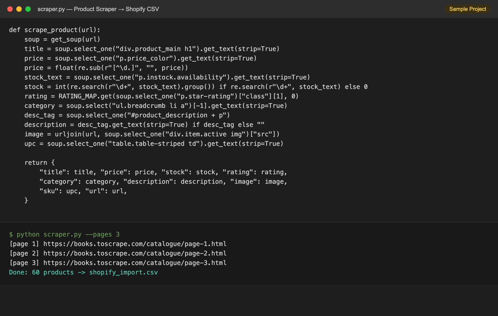

# Shopify Product Scraper 🛒🐍

A Python scraper that collects product data from an online store and converts it into a **Shopify-ready bulk import CSV**, mapping titles, prices, stock, categories, descriptions, images, tags and SEO fields.

This demo targets [books.toscrape.com](https://books.toscrape.com), a public sandbox website built for scraping practice.



## Features

- Crawls catalogue pages and follows pagination
- Extracts title, price, stock quantity, rating, category, description, image URL and SKU
- Generates Shopify CSV columns: `Handle`, `Title`, `Body (HTML)`, `Variant SKU`, `Variant Price`, `Variant Inventory Qty`, `Image Src`, `SEO Title`, `SEO Description`, `Status`…
- Auto-sets out-of-stock products to `draft`
- Polite crawling (request delay, custom User-Agent) and skips broken products without crashing

## Usage

```bash
pip install requests beautifulsoup4
python scraper.py --pages 3 --out shopify_import.csv
```

```
[page 1] https://books.toscrape.com/catalogue/page-1.html
[page 2] https://books.toscrape.com/catalogue/page-2.html
[page 3] https://books.toscrape.com/catalogue/page-3.html
Done: 60 products -> shopify_import.csv
```

Then upload the CSV in **Shopify Admin → Products → Import**.

## Files

| File | Description |
|---|---|
| `scraper.py` | The scraper |
| `shopify_import.csv` | Example output (60 products) |
| `scraped_products.xlsx` | Same output formatted as a spreadsheet |

## Author

**Sajawal Dastagir**, E-commerce & Shopify Specialist · [Portfolio](https://sajawal-dastagir.vercel.app) · [GitHub](https://github.com/sajawalleo) · sajawalkh121@gmail.com
